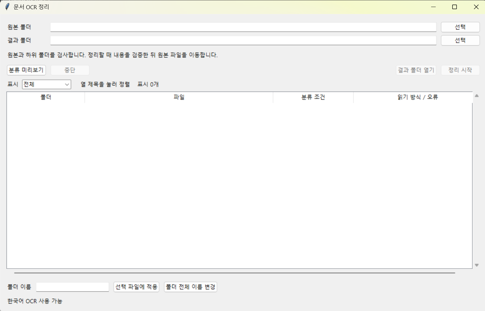

# 문서 OCR 정리

Windows 폴더의 문서를 읽고 비슷한 파일을 폴더별로 정리합니다. PDF·사진은 OCR로 읽고, 중복 파일도 확인합니다.

## 다운로드

[Download app (Windows)](https://github.com/vmvvmvvmv/organizing_folder_auto/releases/latest/download/DocumentOrganizer-Windows.zip)

ZIP 압축을 푼 뒤 DocumentOrganizer 폴더의 DocumentOrganizer.exe를 실행하세요.

## 사용 방법

1. 원본 폴더와 결과 폴더를 선택합니다.
2. 분류 미리보기를 눌러 폴더와 파일을 확인합니다. 필요한 경우 폴더 이름을 바꿉니다.
3. 정리 시작을 누르면 파일이 결과 폴더로 이동합니다. 처리 결과는 CSV 파일로 저장됩니다.

라이선스: [AGPL-3.0](LICENSE)
