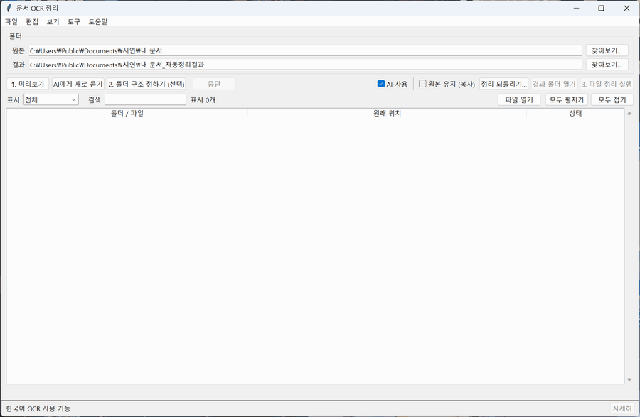
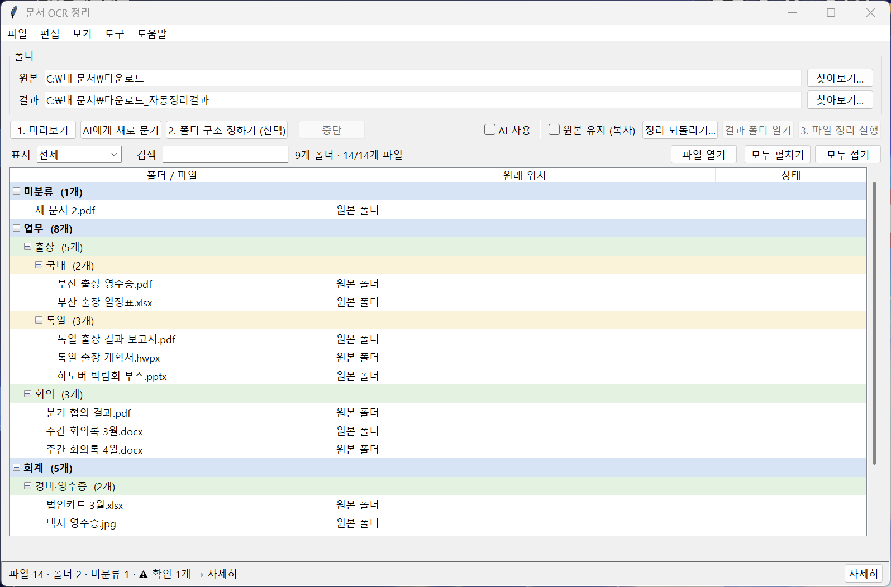

# 문서 OCR 정리

여기저기 흩어진 문서를 읽어서 내용이 비슷한 것끼리 폴더로 나눠 주는 Windows 앱입니다. PDF·사진·한글(hwpx)·워드·엑셀 파일의 내용을 읽고 이 PC에서 도는 AI가 폴더 이름을 정합니다. 파일을 옮기기 전에 결과를 먼저 보여 주고 옮긴 뒤에도 되돌릴 수 있습니다.



## 이런 걸 해 줍니다

- 파일명이 `스캔_20261014_20.pdf`나 `최종_진짜최종_….docx`처럼 엉망이어도 본문을 읽어서 분류합니다. 스캔 PDF와 사진은 OCR로 읽습니다.
- 원하는 폴더 구조가 있으면 먼저 정해 둘 수 있습니다. 직장인·학생 같은 템플릿이나 이미 정리해 둔 폴더의 구조를 가져와도 됩니다.
- 옮기기 전에 미리보기 화면에서 파일을 다른 폴더로 끌어 놓거나 폴더 이름을 바꿀 수 있습니다. 잘못 고쳤으면 Ctrl+Z로 되돌립니다.
- 내용이 똑같은 파일은 하나만 남기고 정리합니다.
- 파일을 옮길 때마다 내용이 같은지 확인한 뒤 원본을 지웁니다. 원본을 아예 남기고 싶으면 **원본 유지 (복사)**를 켭니다.
- 정리한 뒤에도 **정리 되돌리기…**로 원래 자리에 돌려놓을 수 있습니다.
- AI도 이 PC에서 돌아가므로 문서 내용은 인터넷으로 나가지 않습니다.



## 다운로드

[Windows 앱 다운로드](https://github.com/vmvvmvvmv/organizing_folder_auto/releases/latest)

받은 실행 파일은 설치 없이 바로 실행됩니다. AI 분류는 지금은 소스 코드에만 들어 있습니다([소스에서 실행하기](#소스에서-실행하기)).

## 사용 방법

먼저 위쪽 **원본** 칸에 정리할 폴더를 고릅니다(Ctrl+O). **결과** 칸에는 원본 옆의 `원본이름_자동정리결과` 폴더가 자동으로 채워지고, 다른 곳으로 바꿔도 됩니다.

1. **① 미리보기**(F5)를 누릅니다. **AI 사용**을 켜 두면 AI가 폴더를 나눕니다. 이때 파일은 아직 제자리에 있습니다.
2. **② 폴더 구조 정하기**는 원하는 폴더 이름이 있을 때만 씁니다. 창을 열면 AI가 만든 폴더가 들어갈 파일 수와 함께 채워져 있습니다.
   - 지우고, 이름을 바꾸고(더블클릭), **상위 폴더로 묶기**·**하나로 합치기**로 다듬은 뒤 저장합니다.
   - **목록 채우기**에서 템플릿(직장인·학생·자영업·프리랜서·가정)이나 내 폴더 구조를 가져올 수 있습니다.
   - **AI가 묶어 주기**를 누르면 비슷한 폴더끼리 상위 폴더로 묶어 줍니다.
   - 저장하면 그 목록에 맞춰 미리보기가 바로 다시 정리됩니다. 목록에 안 맞는 파일은 미분류로 둘지, AI가 만든 폴더에 그대로 둘지 고릅니다.
3. 목록을 확인하고 고칩니다. 파일은 다른 폴더로 끌어 놓고, 이름은 더블클릭해서 바꿉니다. **파일 열기**를 누르면 그 파일이 연결된 프로그램으로 열립니다.
4. **③ 파일 정리 실행**을 누르면 파일이 결과 폴더로 옮겨지고 `정리_결과_….csv` 기록이 남습니다. 끝나면 결과 폴더를 바로 열 수 있습니다.
5. 되돌리고 싶으면 **정리 되돌리기…**에서 그 CSV를 고릅니다.

### 알아 두면 좋은 것

- 한 번 읽은 내용과 AI 답은 이 PC(`%LOCALAPPDATA%\DocumentOrganizer`)에 기억해 두고 다음 미리보기 때 다시 씁니다. 그래서 같은 폴더를 다시 미리보기하면 금방 끝납니다. AI에게 처음부터 다시 묻고 싶으면 **AI에게 새로 묻기**를 누릅니다(본문 읽기와 OCR은 다시 하지 않습니다).
- 미리보기 결과는 자동으로 저장됩니다. 창을 닫았다가 **파일 ▸ 지난 미리보기 열기**로 이어서 할 수 있습니다.
- 아래 상태 표시줄 오른쪽 **자세히**를 누르면 분류 점검 결과와 구조 점수(기록관리 지침 기준)를 볼 수 있습니다.
- 코드 프로젝트(`package.json`·`.git` 등이 있는 폴더)와 `node_modules` 같은 도구 폴더는 건드리지 않습니다. 그 밖에 빼고 싶은 폴더나 파일은 **도구 ▸ 설정…**에 `개인`, `*.tmp`처럼 적어 둡니다.
- 정리하기 전에 결과 폴더가 있는 드라이브에 공간이 충분한지 확인합니다.
- 분류하는 동안 PC가 버벅이면 **도구 ▸ 설정…**에서 **다른 작업 우선**을 켭니다. 대신 분류가 느려집니다.

### 단축키

| 키 | 하는 일 |
|---|---|
| Ctrl+O | 원본 폴더 고르기 |
| F5 / Shift+F5 | 미리보기 / AI에게 새로 묻기 |
| Ctrl+L | 폴더 구조 정하기 |
| Ctrl+F | 목록 검색 |
| Ctrl+Z | 목록에서 고친 것 되돌리기 |
| F2 | 이름 바꾸기 |
| Esc | 작업 중단 |

## AI 준비

**AI 사용**을 처음 켜면 앱이 필요한 것을 확인하고 하나씩 물어봅니다.

1. Ollama가 없으면 Windows 패키지 관리자(winget)로 공식 Ollama를 설치할지 묻습니다. 설치돼 있는데 꺼져 있으면 켭니다.
2. AI 모델(모두 약 3GB)이 없으면 앱 안에서 받을지 묻습니다. 모델은 처음 한 번만 받습니다.

winget이 없는 PC라면 [Ollama](https://ollama.com/download/windows)를 직접 설치한 뒤 다시 켜세요. 명령으로 준비해도 됩니다.

```powershell
winget install --exact --id Ollama.Ollama
ollama pull qwen3-embedding:0.6b
ollama pull qwen3:4b-instruct
```

AI를 끄면 파일명에 자주 나오는 단어로 폴더를 나눕니다.

## AI가 엉뚱한 폴더를 만들지 않도록

- 파일명이나 본문에 나오지 않는 폴더 이름은 받지 않고 미분류로 둡니다. 영어처럼 한국어가 적은 문서는 단어 대신 뜻이 가까운지로 확인합니다.
- 문서 안에 "이전 지시를 무시하라" 같은 AI용 지시 문장이 있으면 그 문장은 AI에 보내지 않습니다.
- GIS(.shp 등)나 프로그램 구성 파일처럼 함께 있어야 하는 파일은 같은 폴더로 옮깁니다.
- 같은 주제가 여러 폴더로 갈라지면 내용이 아주 비슷한 폴더끼리 합칩니다. 원래 폴더 이름은 분류 이유에 남습니다.
- 판단할 단서가 없는 파일은 억지로 넣는 대신 미분류에 남깁니다.

## 읽을 수 있는 파일

PDF, 사진(png·jpg·tif·bmp), hwpx, docx, xlsx, pptx, txt·md·csv·tsv. 그 밖의 파일은 파일명과 확장자로 분류합니다. 100MB가 넘는 파일은 내용을 읽지 않습니다.

## 소스에서 실행하기

Python 3.11과 [Tesseract OCR](https://github.com/UB-Mannheim/tesseract/wiki)이 필요합니다. 한국어 OCR 데이터(`models\kor.traineddata`)는 저장소에 들어 있습니다.

```powershell
py -3.11 -m venv .venv
.venv\Scripts\python.exe -m pip install -r requirements.txt
.\start.cmd
```

실행 파일은 이렇게 만듭니다.

```powershell
.venv\Scripts\python.exe -m pip install -r requirements-build.txt
powershell -ExecutionPolicy Bypass -File .\build_exe.ps1 -Name DocumentOrganizerAI
```

테스트: `.venv\Scripts\python.exe -m unittest discover -s tests`

## 라이선스

[AGPL-3.0](LICENSE). 함께 들어 있는 프로그램의 라이선스는 [THIRD_PARTY_NOTICES.txt](THIRD_PARTY_NOTICES.txt)에 있습니다.
